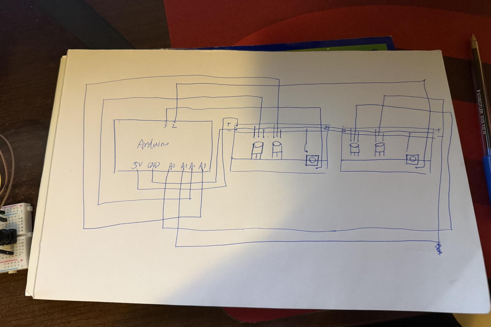

# Penalty Mind Games

Penalty Mind Games is a two-player football penalty shootout game that connects physical Arduino controls to a web interface.

## Project Deliverables

- [Arduino Code](cwiot/project.ino)
- [Schematic View](#schematic-view)
- [Moodboard](#moodboard)
- [Figma UI](#figma-ui)
- [Web Prototype](#web-prototype)
- [Video Demonstration](#video-demonstration)

## Schematic View

The project uses an Arduino UNO, four potentiometers, two push buttons, two breadboards and jumper wires.

### Shooter Controls

- **Aim (A0):** Adjusts the shooting direction.
- **Power (A1):** Controls shot power and ball speed.
- **Shoot (D2):** Starts the penalty shot.

### Goalkeeper Controls

- **Move (A2):** Moves the goalkeeper horizontally.
- **Jump Height (A3):** Adjusts the goalkeeper's jump height.
- **Jump (D3):** Triggers a jump.

Each potentiometer connects to 5V, GND and its analog input pin. The two buttons connect to their digital input pins and GND and use `INPUT_PULLUP`.

## Arduino Code

[View the Arduino program](project.ino)

The Arduino reads the potentiometers using `analogRead()` and the buttons using `digitalRead()`. It sends six numbers over USB Serial at 115200 baud.

The data format is:

`AIM,POWER,SHOOT,MOVE,ANGLE,JUMP`

The web interface reads these values to update the game controls. The Angle input is used to control the goalkeeper's jump height.

## Moodboard

Our visual inspiration combines arcade gaming, football video games, stadiums and Cristiano Ronaldo penalty moments. These references influenced the game's two-player controls and football atmosphere.

## Figma UI

[View the Figma UI design](https://www.figma.com/design/aXMLm7GLLTBAFonM3a9o9d/Xiaoze---aahph?node-id=12-79)

The interface has two pages: team selection and penalty shootout.

## Web Prototype

[View the web prototype](dww/index.html)

The website uses HTML for page structure, CSS for styling, JavaScript for game logic and Web Serial communication, and p5.js for the football field and animations.

### How It Works

**Input:** The two players use four potentiometers and two buttons.

**Processing:** The Arduino sends its readings through USB Serial. JavaScript receives the values and updates the game variables.

**Output:** The web interface updates the aiming guide, ball speed, goalkeeper position and jump height. A shot touching the goalkeeper is saved; otherwise, the game checks whether the ball enters the goal.

### How to Run

1. Upload the Arduino program to the Arduino UNO.
2. Connect the controller to a computer using USB.
3. Close the Arduino IDE Serial Monitor.
4. Open `dww/index.html` with VS Code Live Server in Chrome or Edge.
5. Select two teams and start the match.
6. Click **Connect Arduino** and choose the correct USB serial port.
7. Use the physical controllers to play.

## Video Demonstration

[Watch the Penalty Mind Games demonstration on YouTube](https://youtu.be/n33BPK0vZQg)

The video introduces the project, demonstrates the hardware controls and shows how Arduino input affects the web game.

## Conclusion

This project helped us combine Arduino programming, USB Serial communication, HTML, CSS, JavaScript and p5 in an interactive prototype. A possible future improvement is to better make animation vision efficacy.
